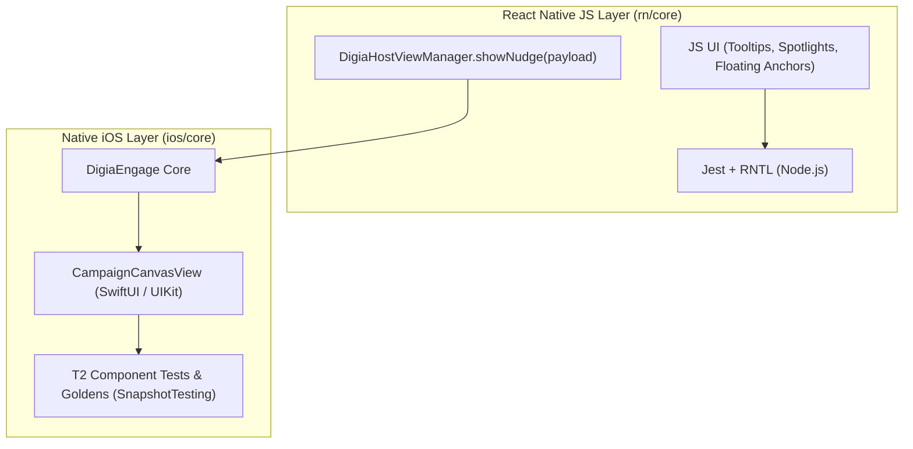

# Digia Engage iOS Test Suite (`DigiaEngageTests`)

This directory contains the automated test suites for the Digia Engage iOS SDK (`ios/core`), covering **Tier 1 (Unit & Domain)** and **Tier 2 (Component, Wire Contracts & Visual Goldens)** in accordance with the [Production Testing Master Execution Plan](../../../ai_docs/production-testing-execution-plan.md).

---

## 1. Do Component Tests Need a Simulator?

**Yes.** Native iOS component and visual golden tests require an iOS Simulator runtime.

### Why:
- **UIKit & SwiftUI Engine**: `CampaignCanvasView`, `NudgeOverlayView`, and `UIHostingController` rely on iOS-specific layout passes, UIKit window hierarchies, and CoreText typography rendering that exist only in `iPhoneSimulator.platform` (not the host macOS runtime).
- **Pixel-Accurate Rendering**: Point-Free `SnapshotTesting` renders the goldens at `@1x` (`ComponentTestHost.renderImage`), as Flutter and Android do, so a pixel in the PNG is a point. Font rasterization and colors must execute against the pinned iOS Simulator profile to match reference goldens deterministically.
- **Headless Execution**: While a simulator runtime is required, **no interactive simulator window needs to be open**. `xcodebuild test` runs headlessly in background/CI environments.

---

## 2. Pinned Reference Simulator Specification (Match Before Testing)

Visual golden diffing (`.image`) requires a deterministic pixel grid, scale factor, and typography rasterizer. All golden snapshots in this repository are recorded against the pinned reference simulator profile below.

> [!IMPORTANT]
> **Check your simulator environment before running visual tests.** If your booted simulator does not match this configuration, visual golden diffs will fail due to scale or dimension mismatches.

### Reference Hardware & Environment Configuration

| Parameter | Pinned Value | Details / Verification |
| :--- | :--- | :--- |
| **Device Model** | `iPhone 17 Pro Max` | 440x956 pt, safe area 62/34; goldens do not use this screen (see below) |
| **OS Version** | `iOS 26.5` | Target simulator runtime |
| **Display Scale** | `@3x` (3.0 scale) | 3 physical pixels per point |
| **Physical Resolution** | `1320 x 2868` px | |
| **Golden Dimensions** | `390 x 844` pt | Set in code (`ViewImageConfig.engageGolden`), not taken from the simulator |
| **UI Appearance** | `Light` | Standard light theme (no dark mode overrides) |
| **Dynamic Type Size** | `large` | Standard iOS default font scale |
| **Golden Safe Area Insets** | Top: 47 pt, Bottom: 34 pt | Set in code, as Flutter's `_safeTop` / `_safeBottom` |

---

### Verifying and Matching Your Simulator

#### 1. Check your booted simulator:
```bash
xcrun simctl list devices booted
```
Verify that `iPhone 17 Pro Max` (iOS 26.5) is listed as `(Booted)`.

#### 2. Boot or switch to the pinned device:
```bash
# Boot the pinned simulator
xcrun simctl boot "iPhone 17 Pro Max"

# Set UI appearance to Light mode
xcrun simctl ui "iPhone 17 Pro Max" appearance light

# Set Dynamic Type to standard default
xcrun simctl ui "iPhone 17 Pro Max" content_size large
```

#### 3. Automatic Device Enforcement:
The [`./run-tests.sh`](../run-tests.sh) convenience runner automatically detects a booted `iPhone 17 Pro Max` on iOS 26.5. If none is booted, it instructs `xcodebuild` to target that device and OS directly.

---

## 3. How React Native iOS (RN-iOS) Relates to These Tests

React Native does not implement a separate canvas rendering engine in JavaScript. Rendering is divided into two distinct layers:



1. **JS-Owned Components (Tooltips, Spotlights, Anchors)**:
   - Tested in `rn/core/tests/` using **Jest + React Native Testing Library (RNTL)**.
   - Runs in pure **Node.js** in milliseconds without requiring Xcode or a simulator.
2. **Native Canvas Campaigns (Nudges, BottomSheets, Fullscreen, Surveys)**:
   - Serialized in JS and passed across the bridge to `DigiaHostViewManager.swift` (`DigiaEngageReactNative` pod).
   - The native view that mounts and displays on the user's screen *is* `ios/core`'s `CampaignCanvasView`.
   - **Visual golden tests in `ios/core/Tests/DigiaEngageTests/VisualRegression/` directly test the exact UI rendered in RN-iOS apps.**
3. **End-to-End Bridge Integration (T3)**:
   - 12 shared Maestro journeys run against `medihub_rn` (or `medihub_ios`) to verify the real touch dispatch, bridge event serialization, and app lifecycle together.

---

## 4. Directory Layout

```text
DigiaEngageTests/
├── VisualRegression/                       <-- [Tier 2] Per-fixture pixel goldens, one file per surface
│   ├── NudgeGoldenTests.swift              <-- goldens/ios/nudge_*/<fixture>.png
│   ├── CanvasGoldenTests.swift, InlineGoldenTests.swift, SurveyGoldenTests.swift, ...
│   └── LegacyGoldenTests.swift             <-- classic_nudge / legacy_nudge / legacy_survey
│
├── Components/                             <-- [Tier 2] Component & contract tests
│   ├── Common/
│   │   ├── SnapshotTestingExtensions.swift <-- Golden viewport & `assertSurfaceGolden`
│   │   ├── ComponentTestHost.swift         <-- Window mounting & 1x `renderImage` / `settledImage`
│   │   ├── GoldenFonts.swift               <-- Registers the shared Roboto
│   │   └── FixtureLoader.swift             <-- Loads <workspace>/sdk_testing_fixtures/... fixtures
│   │
│   ├── Canvas/                             <-- Canvas renderer tests
│   └── Nudge/                              <-- Nudge component, routing & overlay tests
│
├── SessionIdentity/                        <-- [Tier 1 & 2] Session lifecycle, user ID rotation
├── Network/                                <-- [Tier 1 & 2] NetworkClient, retries, mock transports
├── Routing/                                <-- [Tier 1] Surface priority, rules, suppression
├── Analytics/                              <-- [Tier 1] Events, telemetry, health sinks
├── Lifecycle/                              <-- [Tier 2] SDK bootstrapping & startup reliability
├── Contracts/                              <-- [Tier 2] Campaign wire format verification
└── Unit/                                   <-- [Tier 1] ColorHex, Interpolate, typography utils
```

---

## 4a. Shared fixtures, the SDK harness and fixture-behaviour tests

Every fixture-driven suite reads the shared catalog in `<workspace>/sdk_testing_fixtures/`
(`campaigns/<surface>/<name>.json`, `actions/*.json`) — the same files the Flutter and Android tests
read — through `Components/Common/FixtureLoader.swift`. A fixture added there is picked up by the
fixture goldens with no code change (record it, see §6). `{{TESTKIT_ASSET_ORIGIN}}` resolves to the
Test Kit mock server's directory on disk, so no media is fetched.

`Support/SdkHarness.swift` is the port of `flutter/core/test/support/sdk_harness.dart`: it boots the
real `SDKInstance.shared` over a scripted backend (campaign bundle, status, headers, seeded storage
such as frequency state), registers a fake CEP plugin, mounts the app inside `DigiaHost`, delivers
triggers and records what the SDK asked iOS to do (`RecordingPlatform`), the events it tracked and
its diagnostic timeline. It is compiled into both test targets:

- here, where a control is reached through accessibility (`activate(id:)`): no `UIApplication`, so a
  synthesized touch never becomes a gesture;
- in `SampleApp/DigiaEngageSampleTests` (hosted by the sample app), whose `SdkHarness+Touch.swift`
  adds real touches (`tap(id:)`, `tap(text:)`). Drags, backdrop taps, floaters, guides, surveys and
  the action suites live there.

`FixtureBehaviour/` (here and in the sample app) holds the ports of
`flutter/core/test/fixture_behaviour/`, tagged `behaviour`. Each test names, in a `// Fails if:`
comment, the production line whose change turns it red. Where iOS knowingly differs from Flutter the
assertion is wrapped in `withKnownIssue`, so the test fails the day the gap closes.

`CampaignBehaviour/` (here and in the sample app) asserts the exact Digia `/track` chain each surface
sends, beside what the CEP sees. Its support in `CampaignBehaviour/Support/` boots the SDK over the
workspace fixtures through `StubBackend` (a `URLProtocol`, so the real network client and image
pipeline run) and is compiled into both test targets; the cases that need a real touch are in the
sample app.

## 5. Running Tests by Tag

Tagged Swift Testing suites use tags declared in [`TestingTags.swift`](TestingTags.swift): one **kind** (`unit`, `contract`, `component`, `golden`, `integration`), optional **gate** tags (`smoke`, `slow`), and one or more **areas** (`nudge`, `session`, `analytics`, ...). `xcodebuild` selects by tag natively, so no `.xctestplan` is needed.

### Using the Convenience Wrapper (`./run-tests.sh`)
The wrapper pins the iPhone 17 Pro Max (iOS 26.5) simulator, enables code coverage, validates the tag against `TestingTags.swift`, and fails if a filter matched no tests (xcodebuild alone reports success on zero tests):
```bash
./run-tests.sh            # everything under Tests/ (default; same as `all`)
./run-tests.sh golden     # pixel goldens only
./run-tests.sh nudge      # one tag
./run-tests.sh quick      # everything except `slow`
```
`run-tests.sh` runs the package suites, then the suites hosted by the sample app with the same tag filter (`HOSTED=false` skips them). Every run, pass or fail, merges both runs' line coverage of `Sources/` (`Scripts/merge-lcov.py`) and writes it as LCOV to `coverage/lcov.info` and, when `genhtml` is installed (`brew install lcov`), an HTML report at `coverage/html/index.html` (both gitignored).

### Native Xcode commands
```bash
xcodebuild test -scheme DigiaEngage -destination "platform=iOS Simulator,name=iPhone 17 Pro Max,OS=26.5" -enableCodeCoverage YES -only-testing-tags nudge
xcodebuild test -scheme DigiaEngage -destination "platform=iOS Simulator,name=iPhone 17 Pro Max,OS=26.5" -enableCodeCoverage YES -skip-testing-tags slow
# One nested suite, without tags:
xcodebuild test -scheme DigiaEngage -destination "platform=iOS Simulator,name=iPhone 17 Pro Max,OS=26.5" -enableCodeCoverage YES -only-testing:DigiaEngageTests/NudgeComponentTests/Dialog
```
`XCTestCase` classes cannot carry tags; they run only under `all`/`quick` or `-only-testing:`.

---

## 6. Updating Golden Snapshots

The baselines are not in this repository. The per-fixture goldens (`VisualRegression/`) are read
from and recorded into `de_workspace/goldens/ios/<surface>/<name>.png` (`assertSurfaceGolden` in
`SnapshotTestingExtensions.swift`), the same directory and file names as Flutter's and Android's.
Every golden is a fixture golden, as on Flutter and Android. Commit them in `de_workspace`.

When visual designs intentionally change, update the golden baselines using the `RECORD_SNAPSHOTS` environment variable:

```bash
# 1. Re-record goldens for a tag (the run always fails in record mode, by design):
./run-tests.sh nudge record        # or: RECORD_SNAPSHOTS=true ./run-tests.sh nudge

# 2. Verify git diff (in de_workspace):
git -C ../.. diff --stat goldens/ios

# 3. Perform a fresh verification run (must pass without record mode):
./run-tests.sh nudge
```

---

## 7. Inspecting Visual Regressions (When Snapshots Fail)

When a visual golden fails, the test records an issue naming the surface and fixture, with SnapshotTesting's
comparison message, and attaches `<surface>-<name>-actual`, `-reference` and `-difference.png` to the
result bundle:

```text
nudge_dialog/nudge_dialog_radius_28: The percentage of pixels that match 0.14013672 is less than required 0.99
The lowest perceptual color precision 0.0 is less than required 0.98
```

The reference is `de_workspace/goldens/ios/<surface>/<name>.png`.

### Viewing the Visual Difference:

1. **Open the reference and the attached actual image in macOS Preview / Quick Look**:
   ```bash
   open "<reference.png>" "<actual.png>"
   ```

2. **Open with Diff Tools (e.g. Kaleidoscope)**:
   If you have Kaleidoscope or ImageMagick installed, diff them side-by-side:
   ```bash
   ksdiff "<reference.png>" "<actual.png>"
   ```

3. **Open Xcode Test Results (`.xcresult`)**:
   Open the Xcode test result bundle printed at the end of the run to review failure logs and diagnostics inside Xcode:
   ```bash
   open <path_to_Test-...xcresult>
   ```


### Snapshot Determinism Rules:
- **Model contracts**: Text snapshots represent parsed model state; they are not described as rendered view-hierarchy assertions.
- **Image precision**: Isolated goldens use `precision: 0.99`; full-device Nudge goldens use `precision: 0.999` so small component regressions are not hidden by the large background. Both use `perceptualPrecision: 0.98` for minor anti-aliasing variation.
- **Result attachments**: A successful visual golden records its committed reference and current rendered image as per-test PNG attachments; when they differ at all, the helper also forwards SnapshotTesting's `diffV2` `difference.png`. A failed golden uses only SnapshotTesting's native per-test `reference.png`, `failure.png`, and `difference.png` set, avoiding duplicate gallery images. Expand the individual test in Xcode's test report to inspect them.
- **Coverage and insights**: `run-tests.sh` writes code coverage into the `.xcresult` and exports it as LCOV to `coverage/lcov.info`. Xcode generates Insights only when it detects an actionable result, so a clean run can legitimately have an empty Insights section.
